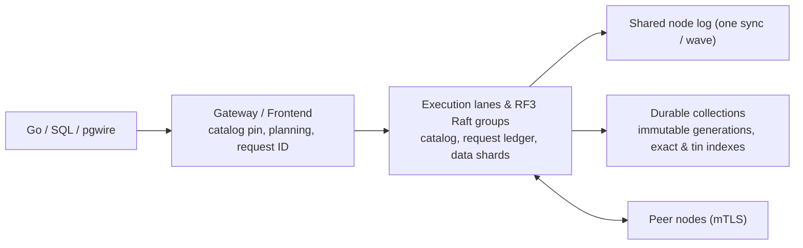

# VibeDB

VibeDB is a JSON document database written in Go. Embed it in-process for
canonical JSON storage, exact secondary indexes, BM25 full-text search, typed
queries, and serializable transactions—or expose it via `database/sql` and the
PostgreSQL v3 wire protocol. The same storage engine also runs as a replicated
RF3 cluster with embedded gateways, independent Multi-Raft groups, exactly-once
writes, online hot-shard splits, and online scale-out/scale-in.

[Get started](docs/getting-started.md) · [Docs](docs/README.md) ·
[APIs](docs/api/README.md) · [Design](docs/design/README.md) ·
[Operations](docs/operations/README.md) · [Reference](docs/reference/README.md)

> **Status:** Pre-release development software. APIs, wire protocols, and disk
> formats may change between commits. Pin a revision and keep binaries and data
> on the same build; see [stability and compatibility](docs/status.md).

## Quick start (embedded Go)

Requires Go 1.27+ (see [go.mod](go.mod)).

```go
package main

import (
	"errors"
	"fmt"
	"log"

	"github.com/thesyncim/vibedb"
)

func main() {
	if err := run(); err != nil {
		log.Fatal(err)
	}
}

func run() (err error) {
	db, err := vibedb.Open("./data")
	if err != nil {
		return err
	}
	defer func() { err = errors.Join(err, db.Close()) }()

	users := db.Collection("users")
	if _, err := users.Put("user:1", []byte(`{"name":"Ada","team":"compiler"}`)); err != nil {
		return err
	}

	doc, found, err := users.Get("user:1")
	if err != nil {
		return err
	}
	fmt.Printf("found=%t doc=%s\n", found, doc)
	return nil
}
```

The default `Durable` profile syncs each mutation's recovery record before
returning, canonicalizes stored JSON, and creates collections on first write.
See the [embedded tutorial](docs/getting-started.md) for reopen verification and
close semantics.

## Interfaces

| Interface | Use for | Guide |
| --- | --- | --- |
| Native Go (`vibedb`) | Embedded JSON collections, exact indexes, serializable transactions | [Native API](docs/api/native.md) |
| Full-text search (`tin`) | Incremental BM25 TINQL search (`==>`, `SCORE()`) with `.tin` sidecar | [Search](docs/api/search.md) |
| Typed queries (`query`) | Reusable compiled plans, explicit snapshots, bounded workspaces | [Query API](docs/api/query.md) |
| `database/sql` | Embedded SQL tables, DDL, and Go connection pooling | [SQL API](docs/api/sql.md) |
| PostgreSQL wire (`pgwire`) | `psql`, `pgx`, `lib/pq`, JDBC; TLS + SCRAM, `pg_stat_activity`, `pg_stat_statements` | [pgwire](docs/api/pgwire.md) |
| RF3 cluster | Replicated SQL across physical nodes with embedded gateways | [Local cluster](docs/operations/local-cluster.md) |

SQL uses the VibeDB dialect, not full PostgreSQL; check the
[SQL reference](docs/reference/sql.md) before porting queries.

## Architecture at a glance



- **Embedded engine:** Readers pin immutable generations; mutations publish
  documents and exact indexes atomically; multi-collection transactions are
  serializable and crash-atomic.
- **Distributed cluster:** Every shard, the catalog, and the request ledger is
  an independent RF3 Raft group sharing a physical node's WAL and execution
  lanes. Durable request identities give exactly-once write recovery.
  Active-standby controller leases (`internal/controllerlease`) drive replica
  moves, hot-shard splits, and scale-out/scale-in without downtime.
- **Observability & operations:** Prometheus `/metrics`, `/healthz`, `/readyz`
  (gateway, RF3 Raft, `ResourceGuard` watermarks, controller lease, version
  window, `pgwire` sessions, `pg_stat_statements`); slow-query observer;
  `vibedb cluster` operator CLI (`init-operator`, `init-node`, `rotate-cert`,
  `policy`, `version --check-peers`, `join`, `rebalance`, `decommission`,
  `status`).

Read [Architecture](docs/architecture.md) and the
[Design guide](docs/design/README.md) for invariants and failure models.

## Key boundaries

- **No cross-build format stability yet:** Rolling mixed-build upgrades and
  cross-build restore are not qualified end-to-end (use
  `vibedb cluster version --check-peers` for pre-flight window checks).
- **Per-group consistency:** No global MVCC snapshot across Raft groups.
- **Online splits:** Base-relation splits are process-qualified; global-index
  and repeated descendant splits are not yet end-to-end qualified.
- **Full-text search:** Active `tin` index stays memory-resident (persisted to a
  checksummed `.tin` sidecar for zero-scan reopen); distributed `==>` is not
  qualified.
- **PostgreSQL wire:** Covers selected client flows, not full PostgreSQL SQL,
  catalog, or extension compatibility.

See [stability and compatibility](docs/status.md), the generated
[embedded capability matrix](docs/capabilities.md), and the
[distributed feature ledger](docs/distributed-feature-state.md).

## Build and test

```sh
make build
make test
```

`make` enables `GOEXPERIMENT=simd`; pass `GOEXPERIMENT=nosimd` for portable
builds (see [SIMD](docs/simd.md)). Read [Contributing](CONTRIBUTING.md), the
[developer guide](docs/development/README.md), and [Security](SECURITY.md).
No project license is published; third-party notices in `LICENSE-*` apply to
their incorporated work.
