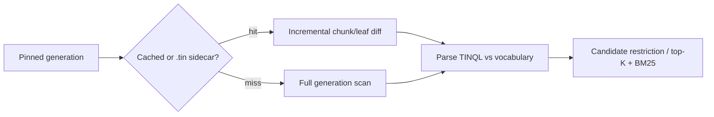

# Full-text search

[Documentation](../README.md) / [API guides](README.md) · [Stability](../status.md)

A **tin index** provides BM25-ranked TINQL full-text search over one JSON
string path across three interfaces:

| Interface | Declare | Search |
| --- | --- | --- |
| Native Go | `Collection.CreateTinIndex(name, path)` | `Collection.TinSearch(path, tinql, topK)` |
| Typed query | Declare via native API | `query.Match(path, tinql)` |
| SQL / pgwire | `CREATE INDEX name ON tbl(path) USING tin` | `path ==> 'tinql'` and `SCORE()` |

Postings are maintained incrementally across generations and persisted in a
SHA-256-checksummed `.tin` sidecar for zero-scan reopen, while the active index
remains memory-resident.

## Search from Go

```go
articles := db.Collection("articles")
_, _ = articles.Put("a1", []byte(`{"title":"Vintage watches","body":"Collecting vintage watches at auction"}`))
_, _ = articles.Put("a2", []byte(`{"title":"Café guide","body":"The best CAFÉS for watching the harbour"}`))
_ = articles.CreateTinIndex("articles_body", "/body")

// Ranked BM25 top-K search
hits, err := articles.TinSearch("/body", `vintage AND watch*`, 10)

// Filter inside a typed query (Latin-1 folding matches "cafes" -> "CAFÉS")
q := query.Select(query.Path("title")).
	Where(query.Match("body", "cafes")).
	OrderBy("title", query.Asc)
res, err := articles.Run(q)
defer res.Release()
```

- `CreateTinIndex(name, path)` takes one RFC 6901 JSON Pointer and materializes
  a lazy collection (`store.ErrIndexExists` on duplicate; `UNIQUE` unsupported).
  On `Memory`, postings build immediately; on `Durable`/`Buffered`, the
  declaration publishes and postings build on first search (may split wide
  primary leaves to 256-slot geometry).
- `TinSearch(path, tinql, topK)` requires the exact declared path spelling
  (`/body`), returns at most `topK` hits by descending BM25 score (`topK <= 0`
  returns empty; missing index returns `store.ErrIndexNotFound`). Tie order
  depends on profile (lexical key on disk, slot order on `Memory`).

## Search from SQL

```sql
CREATE TABLE docs (id STRING PRIMARY KEY, body STRING);
INSERT INTO docs (id, body) VALUES
    ('d1', 'Luxury vintage watches'),
    ('d2', 'Luxury goods and café culture');
CREATE INDEX docs_body_tin ON docs(body) USING tin;

SELECT id, SCORE() FROM docs
WHERE body ==> 'luxury'
ORDER BY SCORE() DESC
LIMIT 10;
```

- `path ==> 'tinql'` accepts a `?` parameter; non-string, null, and missing
  values never match (and are excluded under `NOT`).
- `SCORE()` returns the row's BM25 score (or `0` on non-match) and works in
  `SELECT`, `ORDER BY`, and `WHERE`. It requires **exactly one** top-level
  `==>` predicate and is unsupported with `GROUP BY`, aggregates, joins,
  subqueries, or set operations.
- A durable catalog holds up to 64 tin declarations; declarations survive
  reopen and `TRUNCATE`, and are removed by `DROP INDEX`.

## Text analysis and TINQL

- **Tokenizer:** Maximal runs of letters, digits, and `_` (`wi-fi` → 2 tokens).
  ASCII lowercased; Latin-1 accented letters fold to ASCII (`é` → `e`,
  `ß` → `s`); other Unicode lowercased via `unicode.ToLower`. No stemming,
  stop words, or synonyms. Terms hash via 64-bit FNV-1a.
- **TINQL:** Follows PlanetScale's TIN query language. Keywords are **UPPER
  CASE** only (`and` is a search term).

| Form | Examples |
| --- | --- |
| Terms & boolean | `luxury goods`, `a AND b`, `a OR b`, `a AND NOT b`, `(a OR b) c` |
| Phrases & slop | `"fuji apple"`, `"fuji apple"~1`, `"xy [a b] z"` |
| Wildcards, fuzzy, regex, ranges | `brew*`, `apple~1`, `apple~0:1`, `(MATCHES hop.*s)`, `aardvark TO cat` |
| Counting | `AT LEAST 2 OF [a b c]`, `AT LEAST 50% OF [a b c d]`, `ALL OF [a b]` |
| Proximity & order | `a NEAR/3 b`, `a THEN/0 b`, `(a OR b) WITHIN 4`, `a BEFORE b` |
| Spans | `(security NEAR/10 threat) ENCLOSES critical`, `apple ENCLOSED BY (apple NEAR/1 fuji)` |
| Positions | `apple IN WORDS 1 TO 3`, `apple IN FIRST 5 WORDS`, `a IN LAST 25 %` |
| Boosts & spelling | `CONTAINS beer~1`, `"alpha beta"^1.5` (boosts in `[0, 10000]`) |

Expansions (`*`, `~`, `MATCHES`, `TO`) resolve against the searched
generation's vocabulary. Fuzzy `word~N` anchors on `word` being present in the
vocabulary (byte-wise Levenshtein; `word~P:N` sets shared prefix `P`, default
1). Wildcards/`MATCHES` use Go RE2 across the full vocabulary with no expansion
cap.

## Ranking and execution



- **BM25:** `k1 = 1.2`, `b = 0.75`, smoothed IDF
  `ln(1 + (N - df + 0.5) / (df + 0.5))` from the searched generation's own
  stats. Scores are relative within one generation; SIMD vs scalar may differ
  in the last ulp ([SIMD](../simd.md#full-text-fold-and-bm25-kernels)).
- **Incremental builds & `.tin` sidecar:** Up to 4 generations are cached per
  collection. Newer generations diff changed chunks (`Memory`) or primary
  leaves (`Durable`/`Buffered`), falling back to a full scan on >50% change,
  overflow rows, or schema changes. Durable collections persist sealed postings
  in a SHA-256-checksummed `.tin` sidecar (failing closed to a full scan on
  corruption).
- **Optimizations:** In-memory snapshots with ≥32,768 docs and `GOMAXPROCS >= 2`
  search up to 8 segments in parallel; lone `==>` with `ORDER BY SCORE() DESC
  LIMIT k` reads ranked top-K directly.
- **Transactions:** `==>` / `query.Match` is **refused** on any collection or
  table with staged writes in an active transaction (commit/rollback first),
  and on `FromSegment` / `FromValidatedRaw` sources.

## Limitations

- **Memory-resident:** Active cached generations (up to 4) must fit in RAM.
- **Single path:** One string path per index; no string arrays or multi-field
  weighting.
- **Fixed analyzer:** No stemming, stop words, or custom analyzers; Latin-1
  folding only.
- **Unbounded expansion:** Wildcards, regexes, and fuzzy terms scan the full
  vocabulary per query.
- **Unqualified in RF3:** Schema carries tin declarations, but distributed
  `==>` execution is not qualified. No snippets, highlighting, or facets.

## Source map

- Analyzer, TINQL, BM25: [internal/tin/tin.go](../../internal/tin/tin.go), [parse.go](../../internal/tin/parse.go), [bm25.go](../../internal/tin/bm25.go)
- Heap & durable index builds: [store/store_index_tin.go](../../store/store_index_tin.go), [store/durable/store_file_tin.go](../../store/durable/store_file_tin.go)
- Query binding & scoring: [query/match.go](../../query/match.go), [query/tin_topk.go](../../query/tin_topk.go), [query/score.go](../../query/score.go)
- Tests: [internal/tin/parse_parity_test.go](../../internal/tin/parse_parity_test.go), [sql/driver/tin_fulltext_test.go](../../sql/driver/tin_fulltext_test.go), [vibedb_tin_test.go](../../vibedb_tin_test.go)
