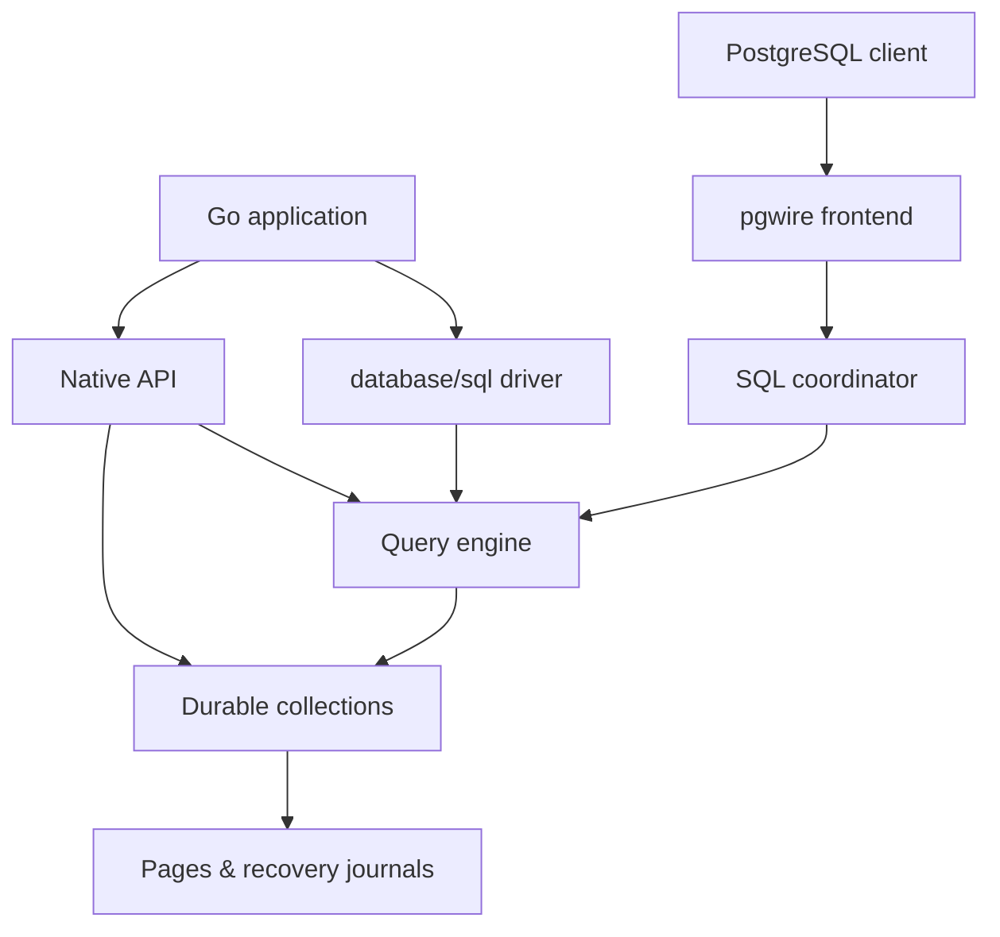
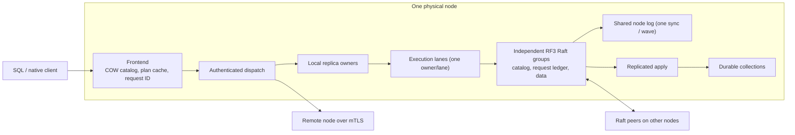

# Architecture

[Documentation](README.md) / [Design](design/README.md) · [Stability](status.md)

VibeDB is an embedded JSON document engine first. SQL, PostgreSQL wire, and
RF3 distributed execution reuse the same collection, index, and publication
machinery.

## Embedded layers

- **Native facade (`vibedb`):** Owns database lifecycle, collections, exact and
  `tin` indexes, typed queries, and serializable transactions.
- **SQL driver (`sql/driver`):** Adds a relational catalog, table schemas,
  isolation levels, and savepoints over durable collections.
- **Query engine (`query`):** Compiles immutable plans, late-binds persistent
  exact and `tin` indexes, enforces bounded workspaces, and rechecks every
  index candidate against the document.
- **Storage (`store`, `store/durable`):** Immutable published generations for
  lock-free reads; heap `store` doubles as a reference model.

## Distributed physical node

In RF3 mode, each physical node embeds a frontend alongside replicas of many
independent Raft groups sharing one segmented node log and execution lanes:

Local dispatch skips sockets and wire encoding while preserving mTLS identity,
authorization, bounds, and serving checks. Physical-node count, Raft-group
count, and replication factor are independent.

## Core data flows

- **Embedded writes:** Validate & canonicalize JSON → build immutable logical
  generation (rows + exact indexes together) → apply durability fence → publish
  atomically. Three publication layers stay distinct: **logical** (visible
  rows/indexes), **topology** (content-equivalent physical shape, so
  `Generation` can advance on a rejected batch), and **durable** (recoverable
  journal/root cut).
- **Embedded transactions:** Single-collection commits use the collection batch
  path. Multi-collection durable commits prepare each participant journal, sync
  all `K` prepares, append/sync one decision in `txn.vtm` (`K+1` syncs), then
  publish atomically.
- **Distributed writes:** Single-group writes commit in one proposal keyed by
  durable request identity. Multi-group writes run a sealed request-ledger
  program through route-gate pins and fused prepare/decide/apply waves.
- **Distributed reads:** Leader reads provide per-group linearizability via
  `ReadIndex` or quorum read authority; follower reads enforce an applied-index
  floor. Multi-group reads combine independent per-group cuts (no global MVCC
  timestamp).
- **Topology changes:** Replica moves, seamless 3↔4 scaling, and hot-shard
  splits are durable, catalog-fenced operations driven by CAS-fenced
  active-standby controller leases (`internal/controllerlease`), moving state
  via certified snapshots rather than Raft `MsgSnap`.

## Key tradeoffs and boundaries

| Choice | Benefit | Constraint |
| --- | --- | --- |
| Immutable generations | Readers never block writers | Long-held snapshots pin extents and must be closed |
| Exact-index candidate rechecks | Exact JSON comparison semantics preserved | Recheck work scales with candidate count |
| Bounded workspaces & admission | Predictable memory and fail-closed errors | Queries fall back to scan or return budget errors |
| Shared node log | One sync per multi-group wave | Group ordering and fences remain strictly independent |
| Lock-free COW snapshots (catalog, plan cache, authorizer) | Zero-contention hot-path reads | Writers pay small copy-on-update cost |

- Embedded packages open no sockets; distributed services require mTLS 1.3
  bound to binary NodeIDs and policy-generation capabilities (plaintext is
  opt-in loopback-only). See [security model](design/security.md).
- `ResidentBytes` and `ResourceGuard` watermarks bound named caches and
  admission, not hard OS RSS/FD limits.

## Source map

- Native facade & transactions: [vibedb.go](../vibedb.go), [vibedb_txn.go](../vibedb_txn.go)
- Query & planner: [query/](../query/), [planner/](../planner/), [query execution](design/query-execution.md)
- Physical node & gateway: [cmd/vibedb-shard/serve_node.go](../cmd/vibedb-shard/serve_node.go), [internal/gatewayruntime/](../internal/gatewayruntime/)
- Consensus & storage: [internal/raftmember/](../internal/raftmember/), [internal/multiraft/](../internal/multiraft/), [internal/raftstore/](../internal/raftstore/), [store/durable/](../store/durable/)
