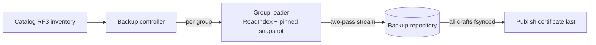

# Backup and restore internals

[Documentation](../README.md) / [Design](README.md) / Backup and restore

An RF3 backup is a certified **vector** of independent per-group Raft cuts.
Restore materializes that vector into a fresh cluster with brand-new
identities, closed to serving until explicitly activated. For commands, see
[RF3 backup and restore](../operations/backup-restore.md).

## Backup: certificate-last cut vector

1. Read the immutable group inventory (catalog, request ledger, data shards).
2. For each group, contact the leader over `vibedb-shard-control`, take a
   `ReadIndex` cut, and stream a two-pass (size/hash + data) artifact straight
   into a repository draft file.
3. After every draft is verified and fsynced, publish the **certificate last**
   and advance the catalog operation.

Only the certificate grants publication authority (orphan drafts are cleaned on
recovery; replay after certificate is idempotent). Export is target-free and
requires only the `backup` capability.

## Restore: fresh identities and gated activation

1. A sealed restore operation binds the certificate, artifact vector, target
   schemas, fresh generation-1 catalog, and policy.
2. Each target root builds non-serving with fresh cluster, group, member, node,
   store, and incarnation IDs; catalog import installs only fresh genesis/head/
   policy rows.
3. Restored replicas start **closed**. `restore-activate` writes an activation
   witness through the target catalog RF3 group, confirms it via a separate
   `ReadIndex` read, and installs process-local serving grants (a restarted
   replica re-observes before serving).

## Limitations

- Per-group cuts only (no cluster-wide MVCC snapshot, RPO, or RTO).
- Cross-build restore and schema migration during restore are unsupported.
- Every export pays 2× logical scan reads; no mandatory CI gate yet combines
  live backup with foreground load and leader loss.

## Source map

- Backup: [internal/clusterbackup/certificate.go](../../internal/clusterbackup/certificate.go), [repository.go](../../internal/clusterbackup/repository.go), [gateway/backup_operation.go](../../gateway/backup_operation.go)
- Restore: [internal/clusterrestore/operation.go](../../internal/clusterrestore/operation.go), [serving_grant.go](../../internal/clusterrestore/serving_grant.go), [internal/restoreservice/installer.go](../../internal/restoreservice/installer.go)
- CI gate: [`restore-rf3-external.yml`](../../.github/workflows/restore-rf3-external.yml)
