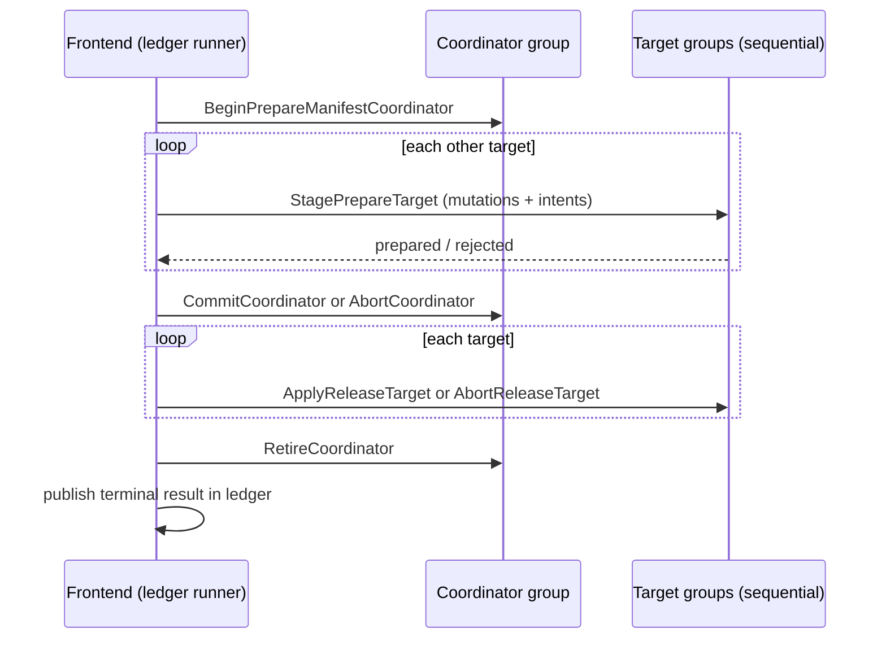

# Distributed transactions

[Documentation](../README.md) / [Design](README.md) / Distributed transactions

Multi-group RF3 writes (cross-shard mutations or base table + independently
placed global indexes) commit atomically through a fused participant protocol
driven by the [request ledger](exactly-once-writes.md). For embedded
serializable transactions, see [transactions](../transactions.md).

## Scope and roles

An RF3 distributed transaction is a single atomic **write program** (`exec_batch`
or one PostgreSQL autocommit statement). Every participant applies or none
does. There are no interactive multi-statement RF3 transactions, read-set
validation, or global timestamps.

- **Coordinator group:** One participant group that stores the transaction
  control record and canonical manifest, fusing its own prepare into `Begin`.
- **Target groups:** All participant groups owning mutations (identified by
  dense schema-authenticated relation IDs; SQL text never enters Raft).
- **Ledger runner:** Any authorized frontend can resume from the ledger's
  sealed program and continuation cursor.

## Fused commit protocol

Adjacent steps fuse into single Raft proposals (`2 × targets + 2` sealed waves
on commit; `3 × targets + 2` on abort):

Each arrow runs inside a [route-gate session](exactly-once-writes.md#request-identity-and-ledger-lifecycle).
Single-group mutations skip coordination (`ApplySingleTarget` or the direct
lane).

## Invariants, intents, and recovery

- **Decision before visibility:** Mutations become visible only at
  `ApplyReleaseTarget` after durable coordinator commit; resident per-group
  transaction state is capped at 128 MiB (paged manifests, no participant-count
  cap).
- **Intents:** Active intents bind `(relation, key)` from prepare until
  release. Conflicting prepares abort; exact-key point reads return
  `ErrTransactionIntentActive`; general SQL reads on a group with *any* active
  intent fail closed (`ErrReplicatedReadIntentActive`) rather than blocking.
- **Deterministic recovery:** Any authorized frontend holding
  `transaction_recovery` resumes from the ledger continuation cursor,
  re-proposing sealed bytes without re-evaluating SQL.
- **Static lane:** Legacy `vibedb-shard serve` uses a journaled coordinator
  with logical recovery pulses (note: static journal compaction omits pulse
  records and is not qualified recovery authority for in-flight coordinators).

## Limitations

- Atomic write programs only (no interactive RF3 `BEGIN`/`COMMIT`).
- Targets prepare sequentially (latency scales linearly with participant count).
- Group-granular SQL read refusal while any intent is active on a group.

## Source map

- Codecs & apply: [internal/distributedtxn/replicated_codec.go](../../internal/distributedtxn/replicated_codec.go), [internal/replicatedstate/transaction_apply.go](../../internal/replicatedstate/transaction_apply.go)
- Runner & recovery: [gateway/replicated_request_transaction_runner.go](../../gateway/replicated_request_transaction_runner.go), [replicated_transaction_recovery.go](../../gateway/replicated_transaction_recovery.go)
- Process tests: [`durable-rf3-multirelation.yml`](../../.github/workflows/durable-rf3-multirelation.yml), [`owner_rf3_multigroup_transaction_test.go`](../../internal/raftservice/owner_rf3_multigroup_transaction_test.go)
