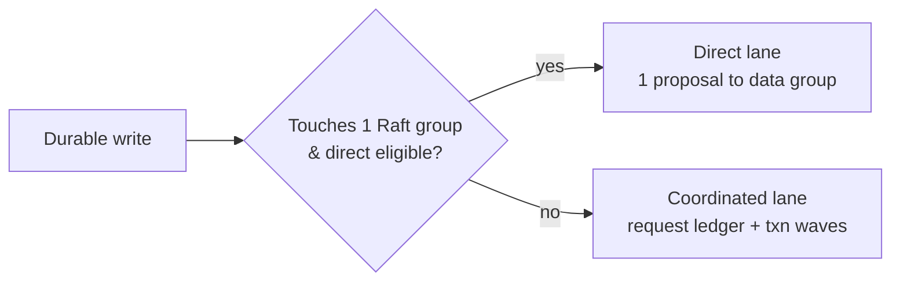

# Exactly-once writes

[Documentation](../README.md) / [Design](README.md) / Exactly-once writes

Because a leader can commit a write and lose the connection before replying,
every durable RF3 write carries an authenticated **request identity**. The
first committed outcome is retained, and recovery re-drives the exact same
identity and canonical bytes until settled.

## Retry contract

| Outcome | Meaning | Required action |
| --- | --- | --- |
| Terminal committed / aborted | Final outcome retained under request ID | Use result; ACK (coordinated lane) to allow GC |
| Pre-admission refusal (`ErrDurableSQLNotAdmitted`) | Never reached a Raft log | Safe to re-plan under a newer catalog / new ID |
| Outcome unknown (disconnect, timeout, leader change) | May have committed | Re-drive the **exact same** identity and bytes |
| Deterministic abort (guard/intent conflict) | Durably rejected by state machine | Start a new attempt with a new identity if retrying |

## Direct vs coordinated lanes

The lanes have independent issuer sequence counters and never silently fall
through across each other:

- **Direct lane (`DirectMutate`):** Single consensus entry on the data group
  (no ledger, route gate, or intents); target transaction control retains the
  terminal result. Eligible exact-PK `UPDATE`s compute the canonical postimage
  once from a leader read and guard apply with the old row's length + SHA-256
  CAS. Cannot recover across a shard split of the key's group.
- **Coordinated lane (`DurableRequestService`):** Used for multi-group writes,
  global-index maintenance, and `exec_batch`. Stateless across frontends—any
  authorized frontend can recover a request from the RF3 request ledger.

## Request identity and ledger lifecycle

`requestledger.RequestKey` binds authenticated principal, 128-bit request ID,
tenant digest, and contiguous `(issuer epoch, lane, sequence)`. Sequence
admission fuses with request-head creation; an issuer high-water mark rejects
retired sequences so GC'd requests can never resurrect.

```mermaid
stateDiagram-v2
    direction LR
    [*] --> Planning: Create + issuer seq
    Planning --> Sealed: immutable recipe pages (≤1 GiB)
    Sealed --> Prepared: result + ACK capability durable
    Prepared --> Terminal: execution pin released w/ cert
    Terminal --> Acked: caller proves ACK capability
    Acked --> [*]: bounded GC (256 rows/step)
```

Once **Sealed**, recovery replays immutable plan pages without re-planning SQL.
Work executes in **waves** (≤256 steps/wave) fenced by:
- **Route-gate sessions (`AcquireShared`/`ReleaseShared` vs `BeginExclusive`/
  `ReleaseExclusive`):** Order request waves against splits, moves, and schema
  drains; route-pin rows in the ledger make every step resumable.
- **Execution pins:** Logical leases measured in catalog applied indexes (no
  wall-clock dependency); takeover requires catalog progress strictly past the
  prior lease fence.

## PostgreSQL autocommit writes

Because the PostgreSQL wire protocol has no client idempotency key, the
frontend maintains a local fsynced outbox (per-table serialized for coordinated
writes, bounded pool for direct writes) so its own attempt is exactly-once
across leader/membership transitions. An application retry on a new PostgreSQL
connection creates a new identity; use native `exec_batch` for end-to-end
client idempotency.

## Limitations

- Direct-lane retries cannot recover across a split of their target group.
- Coordinated waves run sequentially per target; ledger-home ranges do not
  split online.
- RF3 writes support `INSERT VALUES`, branch-aware `ON CONFLICT DO NOTHING/UPDATE`
  (including global indexes), `DELETE`, and exact-PK `UPDATE`; `RETURNING`,
  `ORDER BY`/`LIMIT`, and nested targets remain fenced.

## Source map

- Ledger & apply: [internal/requestledger/types.go](../../internal/requestledger/types.go), [internal/replicatedstate/request_ledger_apply.go](../../internal/replicatedstate/request_ledger_apply.go)
- Service, gates & pins: [gateway/replicated_request_service.go](../../gateway/replicated_request_service.go), [internal/routegate/machine.go](../../internal/routegate/machine.go), [internal/executionpin/transition.go](../../internal/executionpin/transition.go)
- Direct lane & pgwire outbox: [gateway/replicated_direct_mutation.go](../../gateway/replicated_direct_mutation.go), [internal/gatewayruntime/pgwire_write.go](../../internal/gatewayruntime/pgwire_write.go)
- Chaos gates: [`durable-rf3-external.yml`](../../.github/workflows/durable-rf3-external.yml), [`durable-rf3-multirelation.yml`](../../.github/workflows/durable-rf3-multirelation.yml)
