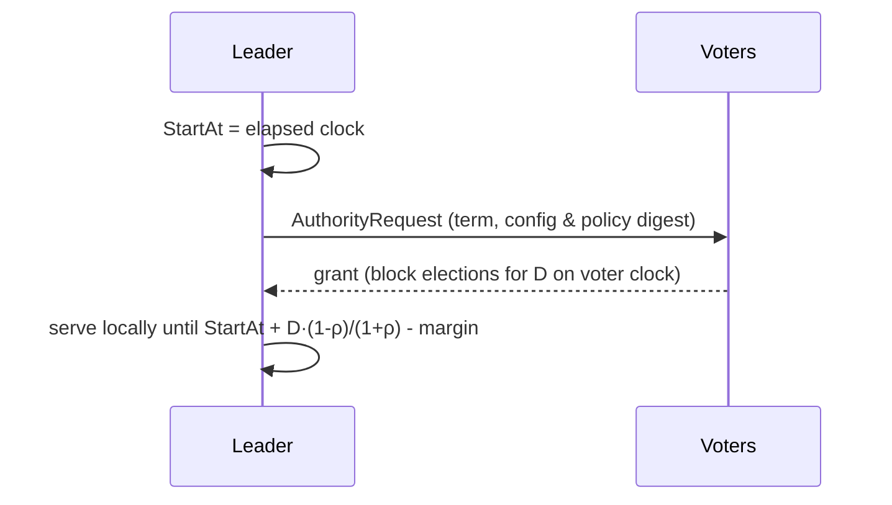

# Reads, leases, and time

[Documentation](../README.md) / [Design](README.md) / Reads and time

Every RF3 read observes a cut of one Raft group. VibeDB has no global MVCC
timestamp, so multi-group reads return independent per-group cuts.

## Read modes

| Mode | Admission | Guarantee |
| --- | --- | --- |
| Leader `ReadIndex` | Serving fence + current leader + quorum `ReadIndex` applied locally | Linearizable per group |
| Leader read authority | Serving fence + valid quorum-granted elapsed-clock token | Linearizable per group (under clock-rate bound) |
| Catalog / ledger / recovery reads | Leader quorum `ReadIndex` only (never lease or follower) | Linearizable authority observation |
| Follower read | Serving fence + local applied index ≥ caller floor | Caller floor only (**not linearizable**, no staleness bound) |
| `read_batch` / SQL `SELECT` | Per-group leader cuts (`read_batch` returns explicit sorted cut vector) | Independent per-group cuts |

Leadership or incarnation loss before apply fails the read closed. Active
transaction intents fail reads closed rather than blocking.

## Read authority

Replaces per-read `ReadIndex` round trips with a quorum-granted lease bound to
a monotonic elapsed clock (`CLOCK_BOOTTIME` on Linux, which counts suspend
time):

- **Default policy (Linux fresh RF3 clusters):** `D = 5 s`, drift bound
  `ρ = 10%`, margin `1 ms` → ~4.09 s usable window and ~6.11 s restart
  quarantine (preventing pre-crash promises from overlapping a new leader).
- **Fail-closed:** Clock rollback permanently disables authority for that owner;
  macOS/non-Linux platforms stay on `ReadIndex`.
- **Tradeoff:** Leader crash failover waits up to `D` for voter promises to
  expire before electing a replacement.

## Time domains

| Domain | Source | Used for |
| --- | --- | --- |
| Raft & logical ticks | Term/index + 50 ms owner ticker | Commit order, elections, WAL cadence, checkpoints |
| Catalog / execution pins | Monotone generations & applied-index intervals | Routing, route gates, cooldowns, request takeover |
| Read authority | `CLOCK_BOOTTIME` elapsed clock | Leader read leases only |
| Wall clock (UTC) | System clock | TLS cert validity, RPC deadlines, retry backoff |

No consensus or ordering decision derives from UTC. CI runs
[`clock-fault-matrix.yml`](../../.github/workflows/clock-fault-matrix.yml) on
Linux to qualify UTC steps (TLS fail-closed), logical pulses, leader isolation,
and process `SIGSTOP`/resume.

## Limitations

- No global MVCC snapshot or bounded-staleness follower reads.
- Read authority is Linux-only and adds up to `D` to crash failover latency.
- Live process UTC stepping is not injected by the clock-fault matrix.

## Source map

- Data reads: [internal/raftservice/data_read.go](../../internal/raftservice/data_read.go), [gateway/replicated_sql_read.go](../../gateway/replicated_sql_read.go)
- Read authority: [internal/raftauthority/authority.go](../../internal/raftauthority/authority.go), [clock_linux.go](../../internal/raftauthority/clock_linux.go), [internal/raftmember/read_authority.go](../../internal/raftmember/read_authority.go)
- Conflict clock: [internal/txnclock/clock.go](../../internal/txnclock/clock.go)
