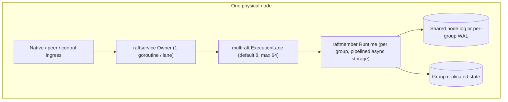
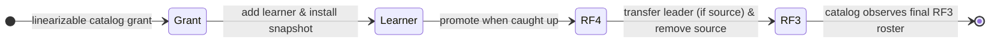

# Replication and Raft groups

[Documentation](../README.md) / [Design](README.md) / Replication

Each data shard, the catalog, and the request ledger is an independent RF3 Raft
group (`go.etcd.io/raft/v3`). Physical nodes colocate replicas from many groups
and share persistence and scheduling without merging consensus domains.

## Consensus configuration

Locked by tests in `internal/raftmodel`:
- `PreVote` + `CheckQuorum` enabled; proposal forwarding disabled; step down on
  removal enabled.
- `ReadOnlySafe` (`ReadIndex`) by default, with optional quorum
  [read authority](reads-and-time.md#read-authority).
- Logical ticks only (1 heartbeat / 10 election ticks; 50 ms ticker in
  `serve-node`/`serve-rf3`)—enabling deterministic simulation (`internal/raftsim`).
- Admission caps: 1 MiB/message, 64 msgs or 8 MiB inflight, 64 MiB uncommitted.

## Execution lanes and runtime

Each group stays pinned to one execution lane; hosts scan only runnable groups.
Shipped serving binaries use the **pipelined** runtime (ordered async storage
with a dedicated append lane). Leaders may send appends concurrently with local
I/O, but votes, follower ACKs, and leader commit contributions wait for local
durability.

## Persistence lanes and log retention

- **Shared node log (default for physical nodes):** `raftstore.NodeStore`
  batches per-group Ready series into checksummed node-level waves
  (`seglog.PersistWave`, one sync per wave). A sync error poisons the handle
  until reopen. A background checkpoint coordinator retires old segments.
- **Per-group WAL:** Preallocated, AES-256-GCM encrypted, digest-chained WAL
  with alternating current slots (`fdatasync` / `F_BARRIERFSYNC` + final
  `File.Sync`). Torn slots quarantine the root rather than guessing. Replaced
  by compacted generations on a 10-minute logical cadence.
- **Retention:** Log truncation follows local checkpoints and does **not** hold
  entries for lagging followers; fallen-behind peers recover via out-of-band
  snapshots.

## Snapshots and membership changes

Raft `MsgSnap` is refused at every boundary (outbound `MsgSnap` is converted to
an append probe). Real state transfer streams certified snapshot artifacts over
a dedicated ALPN (`vibedb-raft-snapshot`), stages non-serving, verifies,
checkpoints, and publishes a new WAL base.

Replica replacement is externally authorized (no joint consensus):

Quorum behavior: 3 or 2 reachable voters commit; 1 or 0 fail closed
(`TestRF3AllThreeVoterQuorumCutsFailClosedOrCommit`).

## Peer transport

Mutual TLS 1.3 with binary NodeIDs in a critical cert extension and per-class
ALPNs ([security](security.md)). Delivery is lossy/duplicating by design;
under backpressure an owner may drop one ordinary packet for Raft to retransmit.
Crash-fault model only (not Byzantine).

## Limitations

- Torn-slot quarantine requires replica replacement (no automatic local repair).
- Several process fault and replica-replacement gates are Linux-only (skip on
  Darwin).
- No mixed-build rolling upgrades yet.

## Source map

- Config & runtime: [internal/raftmodel/config.go](../../internal/raftmodel/config.go), [internal/raftmember/runtime.go](../../internal/raftmember/runtime.go)
- Lanes & service: [internal/multiraft/lanes.go](../../internal/multiraft/lanes.go), [internal/raftservice/owner.go](../../internal/raftservice/owner.go)
- Persistence: [internal/raftstore/node_store.go](../../internal/raftstore/node_store.go), [internal/raftstore/seglog/engine.go](../../internal/raftstore/seglog/engine.go), [internal/raftstore/store.go](../../internal/raftstore/store.go)
- Transport & membership: [internal/rafttransport/transport.go](../../internal/rafttransport/transport.go), [internal/membershipgrant/grant.go](../../internal/membershipgrant/grant.go)
