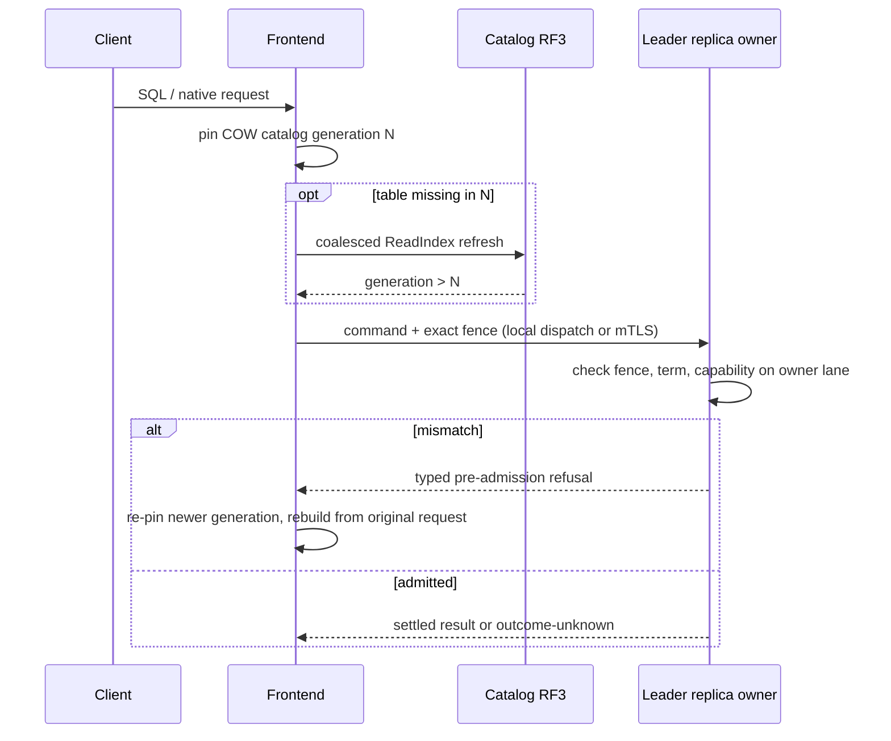

# Request routing and the catalog

[Documentation](../README.md) / [Design](README.md) / Request routing

A frontend (gateway) translates client requests into fenced commands for
specific Raft groups. It pins one immutable catalog generation, attaches exact
fences, and lets each replica reject stale metadata before Raft admission.

## Frontend topologies

- **Physical-node cluster (`vibedb-shard serve-node`):** Every node embeds a
  gateway backed by the replicated RF3 catalog group. Active-standby controller
  ownership (topology, backup, schema, hot-shard, DDL) is coordinated via
  CAS-fenced leases (`internal/controllerlease`); standby frontends serve
  traffic and forward DDL to the active controller.
- **Standalone gateway (`vibedb-gateway serve`):** Wraps `internal/gatewayruntime`
  against a replicated catalog or a static development catalog file.

## Request flow

Local dispatch (`ReplicatedServer.DispatchReplicated`) bypasses sockets and
wire encoding while enforcing the exact same mTLS identity, authorization,
quotas, and serving fences. Hot-path control directory, physical plan cache,
and issuer grant caches use lock-free copy-on-write snapshots.

## Catalog generations and route seeds

- **Pin once per request:** All commands for a request derive from one
  immutable catalog snapshot. Missing-table errors trigger at most one
  coalesced `ReadIndex` refresh; controllers publish forward-only via exact
  predecessor CAS.
- **Replicated catalog authority:** Stored in a dedicated RF3 group with
  idempotent genesis and certified heads (bound to genesis + generation/length/
  digest witness). Readers validate the current head without replaying history.
- **Route seed:** Each frontend persists the last certified catalog group
  location locally and updates it live when scaling relocates the catalog
  group.

## Command fences and route forwarding

Each `ReplicatedRoute` binds:
- **Group key:** cluster ID/incarnation, recovery epoch, shard incarnation, group ID.
- **Command fence:** allocation generation, replica-set version, policy
  generation, protection/ownership epochs, schema generation, relation-manifest
  digest, routing/route versions.
- **Replicas:** exactly 3 serving endpoints (plus at most 1 discovery endpoint
  during moves).

After a split or move, the catalog's **route-forward** table binds old-route
commands to immutable targets (wrapping, never rewriting bytes) until the
source route gate and request-ledger low-water mark pass.

## Schema generations

Schema rollouts advance N → N+1 in four fenced steps:
1. Replicas prepare immutable relation bundles off the serving path and return
   receipts (`internal/schemainstall`).
2. Catalog authorizes a cut binding every group's receipt.
3. Replicas activate only with the exact authorization certificate (mixed
   old/new execution is refused).
4. Prior generation drains through route gates before cleanup.

## Limitations

- Replicated tables support a single scalar string or number placement key.
- General RF3 SQL reads refuse global-index read plans and repartition-exchange
  plans.
- Online `CREATE TABLE` group provisioning is wired only in the `vibedb cluster dev`
  supervisor; repeated schema-rollout artifact recycling remains incomplete.

## Source map

- Catalog & refresh: [gateway/catalog.go](../../gateway/catalog.go), [replicated_catalog_authority.go](../../gateway/replicated_catalog_authority.go), [replicated_catalog_route_seed.go](../../gateway/replicated_catalog_route_seed.go)
- Routes, fences & local dispatch: [gateway/replicated_native.go](../../gateway/replicated_native.go), [internal/raftservice/owner.go](../../internal/raftservice/owner.go), [shardservice/replicated_dispatch.go](../../shardservice/replicated_dispatch.go)
- Forwarding, schema & controller lease: [internal/routeforward/resolve.go](../../internal/routeforward/resolve.go), [internal/schemainstall/types.go](../../internal/schemainstall/types.go), [internal/controllerlease/](../../internal/controllerlease/)
