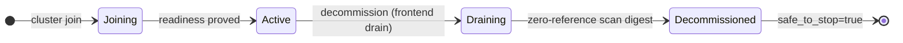

# Topology changes

[Documentation](../README.md) / [Design](README.md) / Topology changes

Replica replacement, node scale-out/scale-in, and hot-shard splits run online
as durable, CAS-fenced catalog operations driven by active-standby controllers
(`internal/controllerlease`). Authority always lives in replicated state, never
controller memory. For commands, see [scaling](../operations/scaling.md),
[node failure](../operations/node-failure.md), and
[hot-shard splits](../operations/hot-shard-splits.md).

## Core mechanisms

- **Catalog operation journals:** Deterministic IDs advanced by CAS; a standby
  controller taking over after lease failover resumes from the exact row.
- **Snapshot transfer (`internal/snapshottransfer`):** Streams authenticated,
  resumable chunks of a certified artifact (never Raft `MsgSnap`) into a
  non-serving target repository; abandonment requires a catalog cancellation
  witness.
- **Replica moves:** Admit move → grant membership → add learner + install
  snapshot → promote to RF4 → transfer leader if source leads → publish catalog
  + drain old route → remove and retire source.

## Seamless scale-out, scale-in, and frontend drain

- **Scale-out / rebalance:** Enrolls an empty node and moves catalog, ledger,
  and data groups uniformly (moving the catalog group rolls every frontend's
  [route seed](routing.md#catalog-generations-and-route-seeds) live).
- **Scale-in & frontend drain:** Closes new public native/pgwire admission
  (`Prepared`), issues a continuation grant for existing sessions (`Enforcing`),
  then retires (`Retired`). By default `safe_to_stop` waits until clients
  disconnect; configuring `FrontendDrainGracePeriod` force-closes lingering
  sessions after the grace window.

## Hot-shard splits

`autosplit` (SABLE) records per-allocation pressure; the clockless `hotshard`
controller admits splits (prioritized over moves); `splitcontroller` drives:
`capture → build artifacts → stage child → catch up tail → seal source →
certify cutover → activate child → adopt runtime → publish catalog → drain →
prune retained → complete`.

## Migration pacing

One per-node `migrationbudget.Budget` paces all transfers (defaults: 2
concurrent heavyweight phases, 16 MiB chunk workspace, 64 MiB/s CPU/disk,
32 MiB/s network). On node-log nodes, a 250 ms pressure sampler applies AIMD
rate scaling (halving down to 12.5% under backpressure or >75% queue; pausing
new phases at >90% for 2 windows; additive +12.5% recovery after 3 quiet
windows; p99 Go scheduler latency >5 ms/20 ms throttles without pausing).

## Limitations

- Base-relation splits are process-qualified (`dev-hot-split.yml`); global-index
  and repeated descendant splits are not yet end-to-end qualified, and splits
  cannot relieve a single hot key.
- Dynamic pressure sampling applies only to the shared node-log lane; per-group
  WAL processes use static rates.
- Replica-replacement process gates are Linux-only (skip on Darwin).

## Source map

- Snapshot & moves: [internal/snapshottransfer/repository.go](../../internal/snapshottransfer/repository.go), [internal/rebalance/replicated_controller.go](../../internal/rebalance/replicated_controller.go)
- Scaling & drain: [gateway/replicated_scaling.go](../../gateway/replicated_scaling.go), [internal/gatewayruntime/scaling_controller.go](../../internal/gatewayruntime/scaling_controller.go), [internal/gatewayruntime/frontend_drain.go](../../internal/gatewayruntime/frontend_drain.go)
- Splits & pacing: [autosplit/sketch.go](../../autosplit/sketch.go), [internal/hotshard/controller.go](../../internal/hotshard/controller.go), [internal/splitcontroller/reconcile.go](../../internal/splitcontroller/reconcile.go), [internal/migrationbudget/pressure.go](../../internal/migrationbudget/pressure.go)
- CI gates: [`seamless-scale-in-out.yml`](../../.github/workflows/seamless-scale-in-out.yml), [`dev-hot-split.yml`](../../.github/workflows/dev-hot-split.yml)
