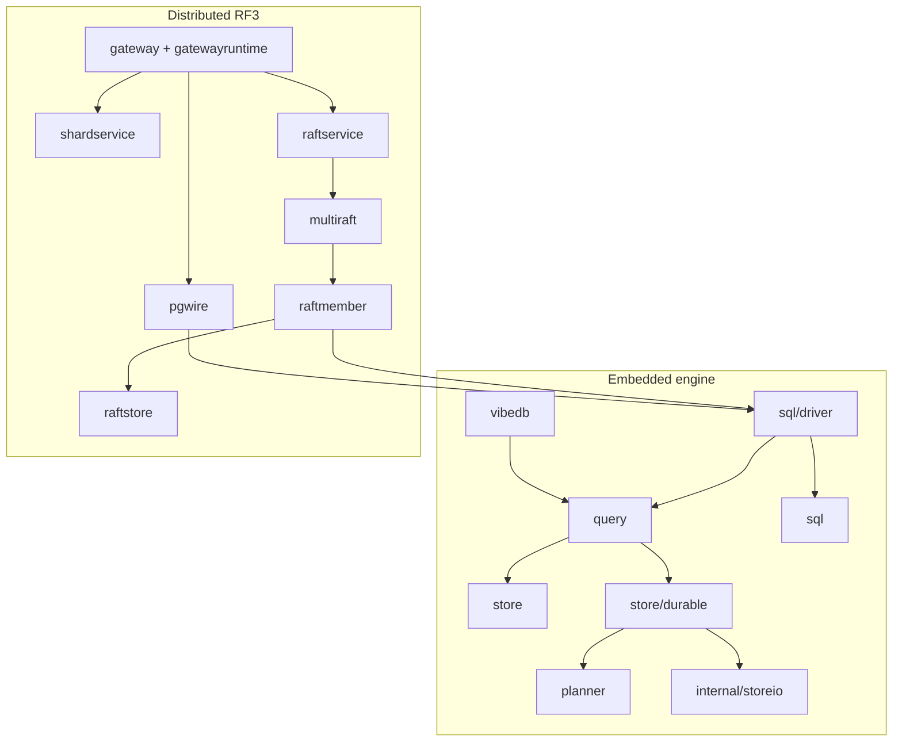

# Repository map

[Documentation](../README.md) / [Developer guide](README.md)

Package ownership across the root module and nested modules. Regenerate the
raw list with `GOEXPERIMENT=simd go list -f '{{.ImportPath}}: {{.Doc}}' ./...`.

## Layer dependencies

## Binaries (`cmd/` & `bench/`)

- `cmd/vibedb` — Local RF3 launcher (`cluster dev`) and cluster control / PKI / policy / version CLI.
- `cmd/vibedb-shard` — Physical-node (`serve-node`), RF3 member (`serve-rf3`), and static shard server.
- `cmd/vibedb-gateway` — Standalone gateway, `schema-rollout`, and `restore-activate`.
- `cmd/vibedb-verify` — Offline `verify`, `salvage`, and `repack`.
- `cmd/vibedb-operator` / `cmd/vibedb-kube-qualify` — Kind qualification manifest renderer and probe.
- `cmd/vibedb-sql-audit` — Static SQL dialect audit tool.
- `bench/gate` / `bench/rf3chaos` — Allocation regression gate and external RF3 fault harness.

## Public library packages

| Package | Responsibility |
| --- | --- |
| `vibedb` (root) | Embedded JSON database facade, profiles, indexes, serializable transactions |
| `store`, `store/durable` | Heap reference engine and file-backed durable collection/database engine |
| `query`, `planner` | Typed query engine, SQL `SELECT` executor, and bounded memo optimizer |
| `sql`, `sql/driver`, `pgwire` | SQL parser, `database/sql` + typed runtime, PostgreSQL v3 wire server |
| `distribution`, `autosplit` | Placement tuple codec, virtual buckets, manifests, and SABLE hot-shard sketches |
| `gateway`, `shardservice`, `shardcontrol` | Routing/coordination, shard RPC servers, and split control protocol |

## Internal package groups

- **Storage & encoding:** `storeio`, `storekey`, `storemem`, `orderedkey`,
  `collectionname`, `buildgate`, `tin` (full-text search), `txnclock`,
  `pginput`, `benchcorpus`.
- **Raft & replication:** `raftmodel`, `raftsim`, `raftstore` (+ `seglog`),
  `raftmember`, `multiraft`, `raftservice`, `raftserve`, `raftauthority`,
  `rafttransport`, `replication`, `replicatedstate`, `requestledger`,
  `resultformat`, `systemkey`, `snapshottransfer`.
- **Gateway, transactions & HA:** `gatewayruntime`, `distributedtxn`,
  `distributedagg`, `exchange`, `executionpin`, `routegate`, `routeforward`,
  `frontenddrain`, `controllerlease`, `clusterversion`, `resourceguard`.
- **Topology & movement:** `rangesplit`, `splitcapture`, `splitartifact`,
  `splitcontroller`, `hotshard`, `topologyscheduler`, `scaling`, `rebalance`,
  `rebalanceexec`, `replicaaction`, `replicacontrol`, `membershipgrant`,
  `migrationbudget`, `nodecontrol`.
- **Schema, backup, security & contracts:** `schemachange`, `schemainstall`,
  `clustercontrol`, `shardcontrol`, `clusterbackup`, `clusterbackupservice`,
  `clusterrestore`, `restoreservice`, `kubeoperator`, `servicetls`,
  `serviceauthz`, `servicemetrics`, `serviceerrors`, `processprofile`,
  `conformance`, `featurestate`, `unsafeaudit`, `rf3bench`, `rf3testfixture`.

## Nested modules and directories

| Path | Contents |
| --- | --- |
| `bench/competitive` | Competitive harness (bbolt, Badger, Pebble, SQLite); generated `COVERAGE.md` |
| `integration/pgclient` | `pgx` v5, `lib/pq`, and `psql` 18.4 client tests |
| `integration/pgcompat` | Pinned PostgreSQL 18.6 regression corpus runner (nightly CI) |
| `x/vitessroute` | Optional Vitess `xxhash`/`multicol` differential oracle (run locally) |
| `integration/jdbc`, `deploy/kubernetes`, `scripts/` | Manual JDBC probes, Kind qualification, CI/bench/docs scripts |
