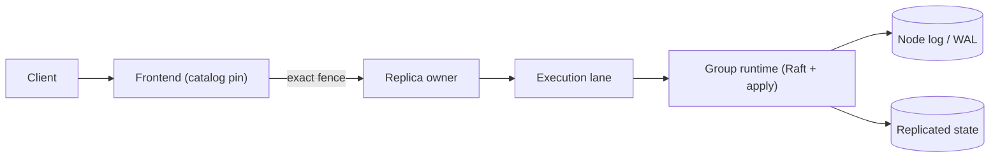

# Distributed internals

[Documentation](../README.md) / [Operations](README.md) · [Design](../design/README.md)

Operator quick-reference for RF3 ownership, quorum, retries, and failure
handling. See the [design guide](../design/README.md#distributed-rf3-design)
for full protocol details.

## Ownership chain

- **Never equate static and RF3:** Static `vibedb-shard serve` endpoints lack
  RF3 request identity, recovery, and quorum guarantees.
- **Physical node ≠ consensus domain:** One `serve-node` process shares a node
  log and execution lanes across many independent RF3 Raft groups.
- **Hard invariants:** Never reuse or copy identities across nodes; never
  hand-edit catalogs, route seeds, or journals; membership changes only via
  catalog-committed grants; every process runs one exact build.

## RF3 quorum and replica replacement

- **3 or 2 voters reachable:** Elects and commits (2 voters = zero remaining
  fault tolerance).
- **1 or 0 voters reachable:** Fails closed; restore quorum or restore from
  backup—never manufacture membership.
- **Replacement sequence:** Catalog grant → add learner → install certified
  snapshot → promote to RF4 → transfer leader if needed → remove source →
  observe final RF3 roster (no joint consensus; retired source is fenced).
  With read authority enabled, leader crash election waits up to 5 s for voter
  promises to expire.

## Retries and outcome-unknown

| Response | Meaning | Action |
| --- | --- | --- |
| Pre-admission refusal (stale fence, not leader) | Never entered Raft | Re-pin newer catalog and rebuild |
| Outcome unknown (disconnect, timeout) | May have committed | Re-drive **exact same** identity & bytes |
| Terminal committed / aborted | Retained final outcome | Use result; ACK coordinated requests |
| Deterministic abort (guard/intent conflict) | Durably rejected | Mint new identity for a new attempt |

Leader reads are linearizable per group (`ReadIndex` or quorum read authority);
follower reads guarantee only the requested applied floor; multi-group reads
combine independent cuts. Active transaction intents fail reads closed.

## Failure quick-reference

| Condition | Safe action |
| --- | --- |
| Leadership lost / stale fence | Refresh route/catalog and retry under same identity |
| Transport backpressure | Relieve load; Raft retransmits dropped ordinary packets |
| Apply failure | Stop runtime; restart to reconcile log and applied state |
| Torn-slot WAL quarantine | Keep non-serving; replace replica |
| Route-seed durability failure | Quiesce and restart frontend |

## Current gaps

- Request-ledger ranges do not split online; globally indexed splits lack
  end-to-end process qualification; local `UNIQUE` indexes are unsupported on
  replicated relations.
- Coordinated multi-group writes prepare participants sequentially.
- Mixed-build rolling upgrades and external CA lifecycle remain out of scope.
  See the generated [distributed feature ledger](../distributed-feature-state.md).

## Source map

- [gateway/catalog.go](../../gateway/catalog.go) · [internal/raftservice/owner.go](../../internal/raftservice/owner.go) · [internal/raftstore/node_store.go](../../internal/raftstore/node_store.go) · [cmd/vibedb-shard/serve_node.go](../../cmd/vibedb-shard/serve_node.go)
