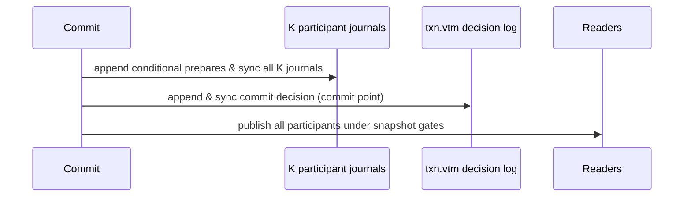

# Transactions

[Documentation](README.md) / [Design](design/README.md) · [Stability](status.md)

The native `vibedb` package provides optimistic **serializable** transactions
across collections. For SQL isolation levels (Read Committed, Repeatable Read,
Serializable) and savepoints, see [SQL API](api/sql.md#transactions-and-savepoints).

## Transaction APIs

| Need | API | Contract |
| --- | --- | --- |
| Read-write transaction | `db.Update(fn)` / `db.Begin()` | Serializable at commit; `Update` rolls back on error/panic, never auto-retries |
| Coherent read-only cut | `db.View(fn)` / `db.BeginReadOnly()` | Single database cut at begin; writes return `ErrTxReadOnly` |
| Heap multi-collection batch | `store.UpdateCollections` | Visibility-atomic to `store.Database.Snapshot`; no persistence |
| Durable multi-collection batch | `(*durable.Database).Update` | Conditional prepares + `txn.vtm` decision |

## Visibility and conflict detection

- `View` captures one coherent database cut at begin.
- `Update` snapshots each collection lazily on first touch plus staged writes
  (read-your-writes). Reads inside `Update` are **provisional** until commit
  succeeds (no opacity)—do not emit external side effects before `Commit`.
- At commit, VibeDB validates exact point reads, absent-key reads, `Put`/`Delete`
  existence assumptions (including ABA), coarse `Range`/`Run` phantom
  dependencies, and lazy-collection creation against every commit since begin.
- Per-transaction exact tracking covers up to 4,096 keys / 1 MiB before
  escalating to a coarse collection dependency; each collection keeps a 4,096-key
  recent-write ring. Conservative `ErrTxConflict` is a normal retry signal—retry
  the entire closure with backoff against a fresh transaction.

## Commit protocol and concurrency

- **Locking:** Commit locks all read/written collections in name order.
  Single-collection transactions commit in parallel across different collections;
  multi-collection transactions take a database-wide commit lock.
- **Profile support:** `Durable` supports crash-atomic multi-collection commits
  (single-collection `Update` provides logical failure-atomic publication, while
  topology preparation may publish a content-equivalent topology generation so
  `Generation may advance` on failure); `Memory` is visibility-atomic;
  `Buffered` rejects multi-collection writes with `ErrTxUnsupportedLane`.
- **Durable multi-collection commit (`K ≥ 2` dirty collections):**

Uses `K+1` syncs. On reopen, a valid decision rolls all participants forward;
absence means presumed abort. An ambiguous decision sync returns
`ErrCommitOutcomeUnknown` and poisons writers—close and reopen the complete
database directory to resolve all-or-none before retrying.

## Default limits

| Scope | Resource | Default |
| --- | --- | ---: |
| Per dirty collection | Distinct keys / staged bytes | 64 / 16,793,600 B |
| Whole transaction | Dirty collections / keys / bytes | 16 / 256 / 67,174,400 B |
| Read tracking | Exact keys / bytes / collections | 4,096 / 1 MiB / 128 |

Exceeding a write limit returns `ErrTxTooLarge` and leaves the `Tx` usable.
Configure whole-transaction write limits via `AdvancedOptions.TxnLimits`.

## Limitations

- No savepoints, nested `Update`/`View` (`ErrTxNested`), or automatic retry in
  the native facade.
- Optimistic validation provides no opacity before commit; heavy churn or long
  transactions trigger conservative conflicts.
- `==>` / `query.Match` is refused on a collection with staged writes.

## Source map

- Facade & clock: [vibedb_txn.go](../vibedb_txn.go), [internal/txnclock/clock.go](../internal/txnclock/clock.go), [history.go](../internal/txnclock/history.go)
- Durable decision & recovery: [store/durable/store_database_txn.go](../store/durable/store_database_txn.go), [store_database_txn_recovery.go](../store/durable/store_database_txn_recovery.go)
- Tests: [vibedb_txn_serializable_test.go](../vibedb_txn_serializable_test.go), [store/durable/store_database_txn_crash_test.go](../store/durable/store_database_txn_crash_test.go)
